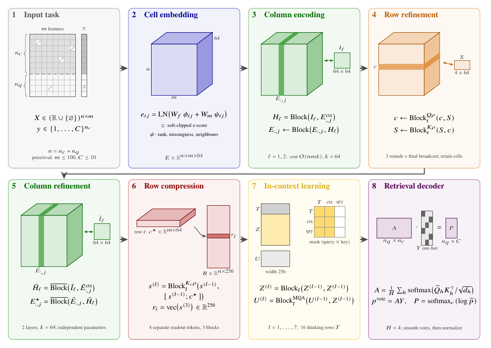

<div align="center">
  
  <h1>LightPFN</h1>
  <p><strong>Modelli fondazionali tabellari compatti da circa 4,7 milioni di parametri per classificazione e regressione.</strong></p>
  <p>Preaddestrati solo su dati sintetici. Estimatori scikit-learn che girano su CPU, CUDA, ROCm e GPU Vulkan.</p>

  <p>
    <a href="https://pypi.org/project/LightPFN/"></a>
    <a href="https://huggingface.co/ueuegio/LightPFN"></a>
    <a href="https://github.com/GioOtto/LightPFN/blob/main/paper/LightPFN15_report.pdf"></a>
  </p>

  <p>
    <a href="docs/it/GUIDA.md">Guida</a> &nbsp;&nbsp;
    <a href="docs/it/RISULTATI.md">Risultati</a> &nbsp;&nbsp;
    <a href="docs/it/VULKAN.md">Backend Vulkan</a> &nbsp;&nbsp;
    <a href="docs/it/ADDESTRAMENTO.md">Addestramento</a> &nbsp;&nbsp;
    <a href="CHANGELOG.md">Changelog</a>
  </p>
  <p><a href="README.md">English</a> &nbsp; <strong>Italiano</strong></p>
</div>

LightPFN è una famiglia di prior-data fitted network: transformer preaddestrati una volta su milioni di tabelle
sintetiche. `fit` codifica il training set come contesto e `predict_proba`, `predict` o `predict_quantiles`
rispondono in un solo passaggio in avanti. Nessun addestramento sui tuoi dati e nessun iperparametro da regolare.

- **Piccolo:** 4,61 milioni di parametri per il classificatore (da 2 a 10 classi), 4,77 per il regressore (media
  e 999 quantili), circa 19 MB di pesi ciascuno. Pensato per girare sulla CPU di un portatile come su una GPU.
- **Accurato senza tuning:** nella classifica ufficiale di [TabArena](https://huggingface.co/spaces/TabArena/leaderboard),
  LightPFN 1.1 è sopra tutti i metodi ad alberi in classificazione, anche quelli ottimizzati.
- **Veloce:** inferenza fp16 su CUDA/ROCm e un backend Vulkan per GPU AMD, Intel e NVIDIA senza CUDA né ROCm.
- **Aperto:** codice, pesi e pipeline di addestramento sotto Apache 2.0. Addestrato da zero solo su dati
  sintetici, senza distillazione e senza pesi o output di altri modelli fondazionali tabellari.

## Installazione

```bash
pip install LightPFN             # CPU, CUDA o ROCm, tramite il PyTorch installato
pip install "LightPFN[vulkan]"   # aggiunge il backend GPU Vulkan
```

Python 3.10 o successivo. Il primo `fit` scarica il checkpoint necessario (circa 19 MB) da
[Hugging Face](https://huggingface.co/ueuegio/LightPFN) al commit fissato nel pacchetto. Su una macchina senza GPU
conviene installare prima PyTorch dall'indice CPU: `pip install torch --index-url https://download.pytorch.org/whl/cpu`.

## Esempio rapido

```python
from sklearn.datasets import load_breast_cancer, load_diabetes
from sklearn.model_selection import train_test_split

from lightpfn import LightPFNClassifier, LightPFNRegressor

X, y = load_breast_cancer(return_X_y=True)
X_train, X_test, y_train, y_test = train_test_split(X, y, stratify=y, random_state=0)
clf = LightPFNClassifier().fit(X_train, y_train)
proba = clf.predict_proba(X_test)

X, y = load_diabetes(return_X_y=True)
X_train, X_test, y_train, y_test = train_test_split(X, y, random_state=0)
reg = LightPFNRegressor().fit(X_train, y_train)
pred = reg.predict(X_test)
interval = reg.predict_quantiles(X_test, quantiles=[0.1, 0.9])
```

I DataFrame pandas si passano così come sono: colonne category, string, object e bool e valori mancanti sono
gestiti nativamente. Con il default `cat="auto"` anche le colonne intere con 2-20 valori distinti sono trattate
come categoriche. Gli estimatori funzionano con `Pipeline`, `GridSearchCV`, `clone` e `cross_val_score`. Altri
esempi in [examples/](examples/) e nella [guida](docs/it/GUIDA.md).

## Dispositivi e precisione

`device="auto"` (default) usa una GPU CUDA o ROCm tramite PyTorch, altrimenti una GPU Vulkan, altrimenti la CPU;
`"cpu"`, `"cuda[:i]"` e `"vulkan[:i]"` ne scelgono una esplicitamente, e la variabile d'ambiente `LIGHTPFN_DEVICE`
sostituisce `"auto"`. Su CUDA/ROCm, `precision="auto"` usa fp16 da 2.048 celle di contesto per membro e riesegue
in silenzio in fp32 ogni blocco non finito; `precision="fp32"` forza float32. CPU e Vulkan usano fp32. Dettagli in
[Dispositivi](docs/it/GUIDA.md#dispositivi) e nel [backend Vulkan](docs/it/VULKAN.md).

## Risultati

| Benchmark | LightPFN |
|---|---|
| Classifica ufficiale TabArena, 38 dataset di classificazione (1.1, 11 ottobre 2026) | 21° su 92, Elo 1441 (+69 / -79), sopra tutti i metodi ad alberi |
| Run dei maintainer di TabArena sulla 1.5.0, tutti gli 816 split ([PR #719](https://github.com/autogluon/tabarena/pull/719)) | 36° su 117 in totale (Elo 1426), 29° in multiclasse, 53° su 112 in regressione; sui fronti di Pareto di Elo contro tempo di addestramento e di inferenza |
| 55 dataset di classificazione OpenML-CC18 fuori da TabArena (1.5, un membro) | AUC media 0,910 (CatBoost default 0,902) |
| 23 dataset di regressione OpenML fuori da TabArena (1.5) | RMSE più basso di CatBoost default su 22 su 23 |
| Velocità su GPU, protocollo TabArena (bagging a 8 fold e refit), 31 task di classificazione (1.5.1 contro 1.1.0, stessa RTX 5090) | addestramento 1,65 volte e predizione 1,64 volte più veloci (medie geometriche) |

I modelli fondazionali più grandi (TabICLv2, Kumo-Tabular, Seldon) restano davanti, nettamente in regressione.
Oltre `max_context` righe (20.000 per membro in classificazione, 50.000 in regressione) il contesto viene
sottocampionato. Tabelle, protocolli e intervalli di confidenza: [docs/it/RISULTATI.md](docs/it/RISULTATI.md).

## Come funziona

<p align="center"></p>

Ogni cella è codificata dal suo valore, dal suo rango nella colonna e da un indicatore di valore mancante; un
adattatore categorico aggiunge embedding per livello e statistiche del target ordinate. Due stadi per colonna con
attenzione indotta leggono ogni colonna, uno stadio per riga comprime ogni riga in un vettore e sette blocchi di
in-context learning fanno guardare alle righe di test quelle di training. Un decoder a recupero trasforma
quell'attenzione in probabilità di classe, oppure in momenti del target letti da una testa di quantili. Il
preaddestramento usa solo task sintetici da prior a grafi causali strutturali e a regole, con uno stadio finale su
tabelle fino a 60.000 righe; il classificatore è poi rifinito su tabelle da 64 a 500 feature. Vedi il
[report tecnico 1.5](https://github.com/GioOtto/LightPFN/blob/main/paper/LightPFN15_report.pdf) (in inglese) e la
[guida all'addestramento](docs/it/ADDESTRAMENTO.md).

I pesi della 1.1 restano disponibili: `pip install lightpfn==1.1.0`, oppure
`LightPFNClassifier(revision="bd389ab59a89dd0e05c9ecb7c642c08ee52e9637", precision="fp32")`.

## Citazione

```bibtex
@techreport{ottoboni2026lightpfn15,
  title  = {{LightPFN} 1.5: Native categoricals, quantile regression, and fast portable inference under 5 million parameters},
  author = {Ottoboni, Giorgio},
  year   = {2026},
  url    = {https://github.com/GioOtto/LightPFN/blob/main/paper/LightPFN15_report.pdf}
}
```

Il [report della 1.1](https://github.com/GioOtto/LightPFN/blob/main/paper/LightPFN_report.pdf) è citato in
[CITATION.cff](CITATION.cff). Segnalazioni di bug e pull request mirate sono benvenute: vedi
[CONTRIBUTING](.github/CONTRIBUTING.md).

## Licenza

Codice e pesi: [Apache License 2.0](LICENSE), con l'avviso di attribuzione in [NOTICE](NOTICE). Le dipendenze
mantengono le proprie licenze ([THIRD_PARTY_LICENSES](docs/THIRD_PARTY_LICENSES.md)).
