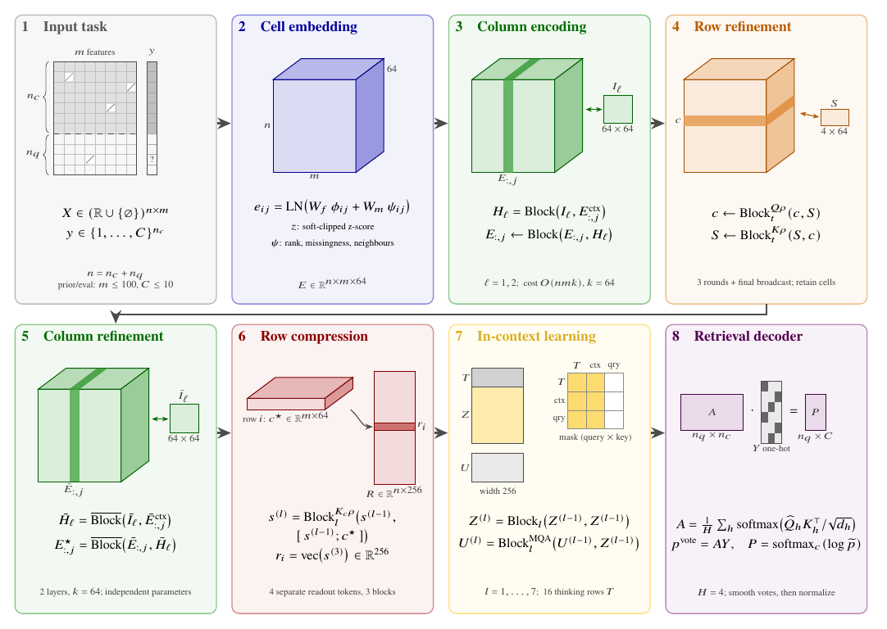

<div align="center">
  
  <h1>LightPFN</h1>
  <p><strong>Compact ~4.7M-parameter tabular foundation models for classification and regression.</strong></p>
  <p>Pretrained only on synthetic data. scikit-learn estimators that run on CPU, CUDA, ROCm and Vulkan GPUs.</p>

  <p>
    <a href="https://pypi.org/project/LightPFN/"></a>
    <a href="https://huggingface.co/ueuegio/LightPFN"></a>
    <a href="https://github.com/GioOtto/LightPFN/blob/main/paper/LightPFN15_report.pdf"></a>
  </p>

  <p>
    <a href="https://github.com/GioOtto/LightPFN/blob/main/docs/en/GUIDE.md">User guide</a> &nbsp;&nbsp;
    <a href="https://github.com/GioOtto/LightPFN/blob/main/docs/en/RESULTS.md">Results</a> &nbsp;&nbsp;
    <a href="https://github.com/GioOtto/LightPFN/blob/main/docs/en/VULKAN.md">Vulkan backend</a> &nbsp;&nbsp;
    <a href="https://github.com/GioOtto/LightPFN/blob/main/docs/en/TRAINING.md">Training</a> &nbsp;&nbsp;
    <a href="https://github.com/GioOtto/LightPFN/blob/main/CHANGELOG.md">Changelog</a>
  </p>
  <p><strong>English</strong> &nbsp; <a href="https://github.com/GioOtto/LightPFN/blob/main/README.it.md">Italiano</a></p>
</div>

LightPFN is a family of prior-data fitted networks: transformers pretrained once on millions of synthetic tables.
`fit` encodes your training set as context and `predict_proba`, `predict` or `predict_quantiles` answer in one
forward pass. Nothing is trained on your data and there are no hyperparameters to tune.

- **Small:** 4.61M parameters for the classifier (2 to 10 classes), 4.77M for the regressor (mean and 999
  quantiles), about 19 MB of weights each. Designed to run on a laptop CPU as well as on a GPU.
- **Accurate without tuning:** on the official [TabArena](https://huggingface.co/spaces/TabArena/leaderboard)
  leaderboard (11 November 2026), LightPFN 1.5 ranks above every tree-based method over all 51 datasets and in
  classification, tuned and ensembled ones included, and is on the Pareto fronts of Elo against train and inference time.
- **Fast:** fp16 inference on CUDA/ROCm, and a Vulkan backend for AMD, Intel and NVIDIA GPUs without CUDA or ROCm.
- **Open:** code, weights and the training pipeline under Apache 2.0. Trained from scratch on synthetic data only,
  with no distillation and no weights or outputs of other tabular foundation models.

## Install

```bash
pip install LightPFN             # CPU, CUDA or ROCm, through your PyTorch install
pip install "LightPFN[vulkan]"   # adds the Vulkan GPU backend
```

Python 3.10 or newer. The first `fit` downloads the needed checkpoint (about 19 MB) from
[Hugging Face](https://huggingface.co/ueuegio/LightPFN) at the commit pinned in the package. On a CPU-only machine,
install PyTorch from its CPU index first: `pip install torch --index-url https://download.pytorch.org/whl/cpu`.

## Quick start

```python
from sklearn.datasets import load_breast_cancer, load_diabetes
from sklearn.model_selection import train_test_split

from lightpfn import LightPFNClassifier, LightPFNRegressor

X, y = load_breast_cancer(return_X_y=True)
X_train, X_test, y_train, y_test = train_test_split(X, y, stratify=y, random_state=0)
clf = LightPFNClassifier().fit(X_train, y_train)
proba = clf.predict_proba(X_test)

X, y = load_diabetes(return_X_y=True)
X_train, X_test, y_train, y_test = train_test_split(X, y, random_state=0)
reg = LightPFNRegressor().fit(X_train, y_train)
pred = reg.predict(X_test)
interval = reg.predict_quantiles(X_test, quantiles=[0.1, 0.9])
```

pandas DataFrames go in as they are: category, string, object and bool columns, and missing values, are handled
natively. With the default `cat="auto"`, integer columns with 2 to 20 distinct values are also treated as
categorical. The estimators work with `Pipeline`, `GridSearchCV`, `clone` and `cross_val_score`. More in
[examples/](https://github.com/GioOtto/LightPFN/tree/main/examples) and in the
[user guide](https://github.com/GioOtto/LightPFN/blob/main/docs/en/GUIDE.md).

## Devices and precision

`device="auto"` (default) uses a CUDA or ROCm GPU through PyTorch, else a Vulkan GPU, else the CPU; `"cpu"`,
`"cuda[:i]"` and `"vulkan[:i]"` select one explicitly, and the environment variable `LIGHTPFN_DEVICE` replaces
`"auto"`. On CUDA/ROCm, `precision="auto"` runs fp16 from 2,048 context cells per member and silently retries
any non-finite block in fp32; `precision="fp32"` forces float32. CPU and Vulkan run fp32. Details in
[Devices](https://github.com/GioOtto/LightPFN/blob/main/docs/en/GUIDE.md#devices) and in the
[Vulkan backend](https://github.com/GioOtto/LightPFN/blob/main/docs/en/VULKAN.md).

## Results

| Benchmark | LightPFN |
|---|---|
| TabArena official leaderboard, all 51 datasets (1.5.1, 11 November 2026) | 31st of 99, Elo 1447 (+53 / -61), above every tree-based method; only KNN trains faster, only EBM predicts faster |
| TabArena official leaderboard, 38 classification datasets | 28th of 103, Elo 1468 (+63 / -62), above every tree-based method |
| TabArena official leaderboard, 13 regression datasets | 47th of 101, Elo 1431 (+129 / -99), above default CatBoost (1410), below tuned gradient boosting; fastest training of all entries |
| 55 OpenML-CC18 classification datasets outside TabArena (1.5, one member) | mean AUC 0.910 (default CatBoost 0.902) |
| 23 OpenML regression datasets outside TabArena (1.5) | lower RMSE than default CatBoost on 22 of 23 |
| GPU speed, TabArena protocol (8-fold bagging and refit), 31 classification tasks (1.5.1 vs 1.1.0, same RTX 5090) | 1.65x faster training, 1.64x faster prediction (geometric means) |

Larger foundation models (TabICLv2, Kumo-Tabular, Seldon) remain ahead, clearly so in regression. Above
`max_context` rows (20,000 per classification member, 50,000 in regression) the context is subsampled. Tables,
protocols and confidence intervals: [docs/en/RESULTS.md](https://github.com/GioOtto/LightPFN/blob/main/docs/en/RESULTS.md).

## How it works

<p align="center"></p>

Each cell is embedded from its value, its rank in the column and a missing-value flag; a categorical adapter adds
level-aware embeddings and ordered target statistics. Two column stages with induced attention read each column,
a row stage compresses each row into one vector, and seven in-context blocks let test rows attend to the training
rows. A retrieval decoder turns that attention into class probabilities, or into target moments read by a
quantile head. Pretraining uses only synthetic tasks from structural causal graph and rule priors, with a final
stage on tables of up to 60,000 rows; the classifier is then fine-tuned on tables of 64 to 500 features. See the
[1.5 technical report](https://github.com/GioOtto/LightPFN/blob/main/paper/LightPFN15_report.pdf) and the
[training guide](https://github.com/GioOtto/LightPFN/blob/main/docs/en/TRAINING.md).

The 1.1 weights stay available: `pip install lightpfn==1.1.0`, or
`LightPFNClassifier(revision="bd389ab59a89dd0e05c9ecb7c642c08ee52e9637", precision="fp32")`.

## Citation

```bibtex
@techreport{ottoboni2026lightpfn15,
  title  = {{LightPFN} 1.5: Native categoricals, quantile regression, and fast portable inference under 5 million parameters},
  author = {Ottoboni, Giorgio},
  year   = {2026},
  url    = {https://github.com/GioOtto/LightPFN/blob/main/paper/LightPFN15_report.pdf}
}
```

The [report of 1.1](https://github.com/GioOtto/LightPFN/blob/main/paper/LightPFN_report.pdf) is cited in
[CITATION.cff](https://github.com/GioOtto/LightPFN/blob/main/CITATION.cff). Bug reports and focused pull
requests are welcome: see [CONTRIBUTING](https://github.com/GioOtto/LightPFN/blob/main/.github/CONTRIBUTING.md).

## License

Code and weights: [Apache License 2.0](https://github.com/GioOtto/LightPFN/blob/main/LICENSE), with the
attribution notice in [NOTICE](https://github.com/GioOtto/LightPFN/blob/main/NOTICE). Dependencies keep their own
licenses ([THIRD_PARTY_LICENSES](https://github.com/GioOtto/LightPFN/blob/main/docs/THIRD_PARTY_LICENSES.md)).
