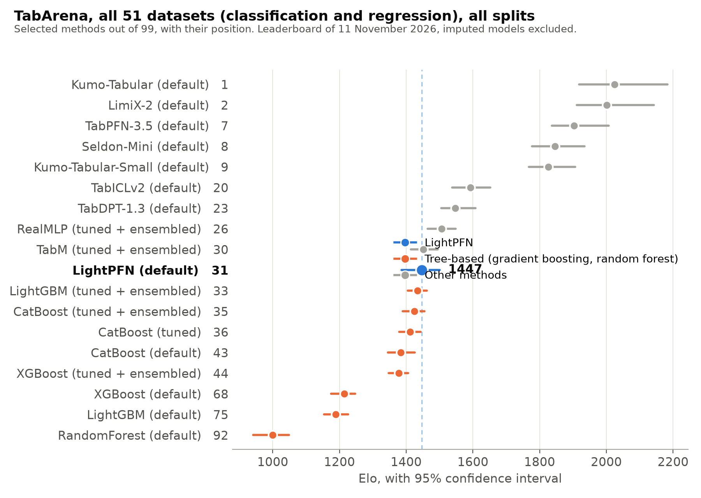
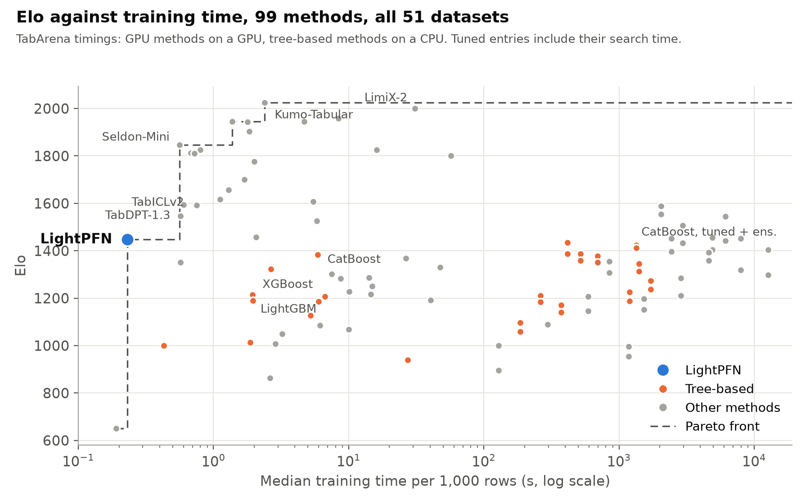
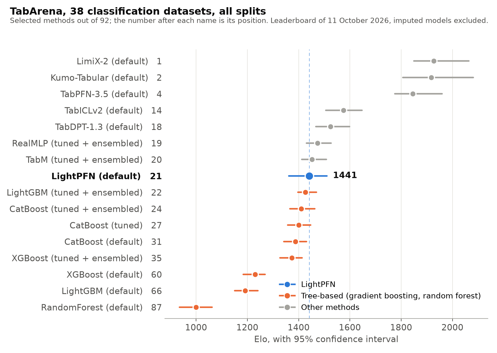
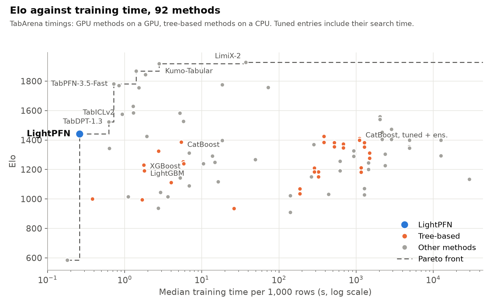

# Results

**English** · [Italiano](../it/RISULTATI.md)

This page reports the results of LightPFN 1.5 (the official TabArena leaderboard and local evaluations) and the
full benchmark results of LightPFN 1.1. Protocols and ablations are described in the
[LightPFN 1.5 technical report](https://github.com/GioOtto/LightPFN/blob/main/paper/LightPFN15_report.pdf) and
the [report of 1.1](../../paper/LightPFN_report.pdf). Since 11 November 2026 the official TabArena leaderboard
entry is LightPFN 1.5.1, run by the maintainers on all 51 datasets; it replaces the LightPFN 1.1 entry
(the long-context checkpoint LC39k in the 1.1 report, 4,603,088 parameters, classification only). The other
1.5 measurements below are local runs.

- [TabArena, official leaderboard of 1.5.1](#tabarena-official-leaderboard-of-151)
- [Results of 1.5 (local evaluations)](#results-of-15-local-evaluations)
  - [Inference speed of 1.5.1](#inference-speed-of-151)
  - [Final second-member rule: CPU fp32 check](#final-second-member-rule-cpu-fp32-check)
- [Results of 1.1](#results-of-11)
  - [Evaluation sets](#evaluation-sets)
  - [Small tables: 55 OpenML datasets outside TabArena](#small-tables-55-openml-datasets-outside-tabarena)
  - [TabArena, official leaderboard](#tabarena-official-leaderboard)
  - [TabArena, 38 classification tasks with our harness](#tabarena-38-classification-tasks-with-our-harness)
  - [Larger tables](#larger-tables)
  - [Cost](#cost)
  - [Categorical features: what did not work](#categorical-features-what-did-not-work)

## TabArena, official leaderboard of 1.5.1

Leaderboard of 11 November 2026 ([TabArena Space](https://huggingface.co/spaces/TabArena/leaderboard), data
commit `e0723ee`). The TabArena maintainers ran **lightpfn 1.5.1** on all 816 splits of TabArena-v0.1 with the
official protocol (eight-fold bagging with refit, `8x1` validation) in its default configuration: four
classification estimators or two regression members, no search space, RTX PRO 6000. They marked the result as
verified; nothing is imputed ([PR #719](https://github.com/autogluon/tabarena/pull/719)). Views with imputed
models excluded:

| View (LightPFN 1.5.1) | Datasets | Position | Elo (95% CI) | Train / predict (s per 1K rows) | Default CatBoost |
|---|---:|---:|---:|---:|---:|
| **All tasks, all splits** | 51 | **31st of 99** | **1447 (+53 / -61)** | 0.23 / 0.019 | 43rd, 1383 |
| All tasks, Lite (first split) | 51 | 30th of 99 | 1433 (+54 / -58) | 0.24 / 0.019 | 45th, 1358 |
| **Classification, all splits** | 38 | **28th of 103** | **1468 (+63 / -62)** | 0.24 / 0.019 | 41st, 1388 |
| Binary, all splits | 30 | 29th of 103 | 1451 (+67 / -62) | 0.19 / 0.014 | 36th, 1408 |
| Multiclass, all splits | 8 | 25th of 103 | 1559 (+146 / -98) | 0.37 / 0.024 | 59th, 1326 |
| **Regression, all splits** | 13 | **47th of 101** | **1431 (+129 / -99)** | 0.16 / 0.024 | 51st, 1410 |
| All tasks, small datasets | | 27th of 99 | 1462 (+73 / -60) | 0.29 / 0.024 | 49th, 1323 |
| All tasks, medium datasets | | 49th of 99 | 1446 (+116 / -116) | 0.08 / 0.015 | 32nd, 1584 |

Elo is computed among the methods of each view, so values are not comparable across rows. With imputed models
included (the default view of the page), LightPFN 1.5.1 is 31st of 110 with Elo 1426 (+49 / -55).

Selected methods, all tasks, all splits. Times are TabArena's medians in seconds per 1,000 rows; tuned entries
include their search time.

| Position | Method | Elo | 95% CI | Train | Predict |
|---:|---|---:|---:|---:|---:|
| 1 | Kumo-Tabular (default) | 2024 | +159 / -106 | 2.39 | 0.253 |
| 2 | LimiX-2 (default) | 2001 | +141 / -90 | 30.94 | 9.028 |
| 7 | TabPFN-3.5 (default) | 1903 | +104 / -67 | 1.84 | 0.473 |
| 8 | Seldon-Mini (default) | 1846 | +88 / -69 | 0.56 | 0.036 |
| 9 | Kumo-Tabular-Small (default) | 1826 | +80 / -58 | 0.80 | 0.092 |
| 20 | TabICLv2 (default) | 1592 | +60 / -54 | 0.75 | 0.139 |
| 23 | TabDPT-1.3 (default) | 1547 | +61 / -42 | 0.57 | 0.176 |
| 26 | RealMLP (tuned + ensembled) | 1506 | +42 / -42 | 2950.72 | 11.975 |
| 30 | TabM (tuned + ensembled) | 1451 | +43 / -37 | 2450.13 | 2.247 |
| **31** | **LightPFN 1.5.1 (default)** | **1447** | **+53 / -61** | **0.23** | **0.019** |
| 33 | LightGBM (tuned + ensembled) | 1434 | +28 / -29 | 417.05 | 2.639 |
| 35 | CatBoost (tuned + ensembled) | 1424 | +31 / -35 | 1346.21 | 0.344 |
| 36 | CatBoost (tuned) | 1412 | +31 / -33 | 1346.21 | 0.038 |
| 43 | CatBoost (default) | 1383 | +42 / -38 | 5.88 | 0.025 |
| 44 | XGBoost (tuned + ensembled) | 1378 | +28 / -31 | 693.49 | 1.689 |
| 68 | XGBoost (default) | 1214 | +33 / -39 | 1.94 | 0.123 |
| 75 | LightGBM (default) | 1189 | +37 / -35 | 1.96 | 0.142 |
| 92 | RandomForest (default) | 1000 | +48 / -59 | 0.43 | 0.054 |

Over all 51 datasets and in classification, the Elo point estimate of LightPFN 1.5.1 is above every tree-based
method, tuned and ensembled ones included. Its interval overlaps those of the tuned gradient-boosting entries
and of default CatBoost, so against them this is not a clear win; default XGBoost and LightGBM are more than 200
points lower, with separate intervals. In regression, the first support of LightPFN on the leaderboard, it is
above default CatBoost (1410) with overlapping intervals, and below the tuned gradient-boosting entries (1442 to 1522);
the larger foundation models are far ahead (Kumo-Tabular-Small 2130, Seldon-Mini 2150, TabICLv2 1712). As with
1.1, the weak spot is the medium datasets (49th of 99, where default CatBoost is 32nd).

LightPFN 1.5.1 is on the Pareto front of Elo against training time in every view of the table above, and against
prediction time in every view except the medium datasets: over all tasks only KNN trains faster and only EBM
predicts faster, both with a much lower Elo. In regression its training time is the lowest of all 101 entries.
TabArena timed LightPFN on a GPU and the tree-based methods on a CPU, so the time axis compares setups as they
were run, not algorithms on equal hardware. On the same hardware the maintainers measured 1.5.0 at 0.290 s train and 0.019 s predict per 1,000
rows over all tasks, and 1.5.1 at 0.235 and 0.019, with the same Elo.

[All tasks CSV](../assets/tabarena_15_all_tasks.csv), [classification CSV](../assets/tabarena_15_classification.csv),
[regression CSV](../assets/tabarena_15_regression.csv) (all splits, imputed models excluded, as published by TabArena).

## Results of 1.5 (local evaluations)

Local results compiled on 9 November 2026, before the official run above. The historical sections further
below describe LightPFN 1.1.

| Measurement (1.5, local) | Result | Protocol and limit |
|---|---|---|
| Classification Lite, final classifier | Elo 1436 (+74 / -65), 1.1 1423; earlier 1.5 classifier 1416 on the same GPU (1415 on RX 7900 XT); 24 lower-error tasks, 14 higher | 38 tasks, first split, RTX 5090; hosted baseline snapshot |
| Regression Lite, final author run | Elo 1450 (+107 / -103), default CatBoost 1416 | 13 tasks, fold 0, RX 7900 XT; final skewness-gated rule |
| Earlier two members versus one | RMSE -1.03% [-1.73, -0.40] D3-reg; -6.72% [-14.12, -1.31] D3-reg-L | 23 and 15 development tasks, full context; previous rule |
| Classification train / predict speed | 1.89x / 2.04x relative to 1.1.0 | Geometric means, 8 tasks, 8 folds x 4 members, same RTX 5090, measured fp16 threshold 8,192 cells |
| Wide-table fine-tuning, final minus earlier 1.5 classifier | D3 > 100 features: AUC +1.93 points [-0.06, +5.82], log loss -0.048 [-0.108, -0.004]; D3 +0.01 [-0.06, +0.09]; Dcat 10k +0.07 [+0.00, +0.16]; D4 +0.12 [+0.05, +0.21]; TabArena first split relative error -0.85% [-1.83, -0.04] | Four members, paired 95% bootstrap; 9, 55, 6 and 13 datasets, 38 TabArena tasks (monitored during the fine-tuning, not independent) |
| Classification, final classifier, one member | D3 AUC 0.9102, Dcat 10k 0.7082 | Same protocols as the rows below |
| Classification, 1.5 classifier before the wide-table fine-tuning | D3 AUC 0.9103 (1.1.0: 0.9109, default CatBoost: 0.9023) | 55 OpenML-CC18 datasets not in TabArena, one member, local |
| High-cardinality categorical tasks (Dcat) | AUC 0.7075 at 10k rows, 0.7134 at 25k (1.1.0: 0.7047 / 0.7098; default CatBoost: 0.7031 / 0.7118) | 6 datasets with high-cardinality categorical columns, one member, local |
| Large tables (D4) | AUC 0.8200 (1.1.0: 0.8188; default CatBoost: 0.8189) | 46 cells, one member, local |

These local speed ratios do not carry over to the official medians (above): the TabArena protocol includes
serialized fold models and a refit, and small tables dominate the medians. The package fp16 threshold is now
2,048 context cells per member. The final default in `LightPFNRegressor` applies `log(y)` only for positive
targets with adjusted sample skewness at least 2 (`log_skew=2.0`), otherwise `-y` (`"flip"`). This rule was
selected on the development sets and is used in the final Lite run above. Earlier wrapper runs scored
1315 and 1351 regression Elo against a smaller baseline snapshot; these are not directly comparable Elo
changes. Final local positions are 34/115 for classification (final classifier; 35/115 for the earlier one) and 54/111 for regression, including imputed
baseline entries. There is no imputation for LightPFN 1.5. Local timings are 0.31/0.041 s per 1,000 rows for
classification train/predict (earlier classifier, RX 7900 XT; final classifier on the RTX 5090: 0.29/0.023) and 0.21/0.033 for regression; other CPU jobs were running, and hosted baseline
times use different hardware.

The final rule gives mean normalized CRPS/RMSE of **0.1748/0.4042** on D3-reg and **0.1546/0.3691** on
D3-reg-L. D3-reg has at most 800 context rows; D3-reg-L has two splits on each of 15 sources with at least
4,000 finite rows, up to 40,000 context rows and 5,000 test rows. These are fixed-weight CPU fp32 results.
Default CatBoost gives RMSE 0.4794 and 0.3689 in the respective protocols; LightPFN wins 22/23 and 11/15
tasks. Its geometric-mean RMSE ratios to CatBoost are 0.791 and 0.921. On the final Lite regression run, the
ratio is 0.972 (8/13 wins), while larger Kumo-Tabular-Small and TabICLv2 beat LightPFN on every task.
D3-reg tree quantiles use held-out residual calibration; D3-reg-L uses point fits, and Lite uses TabArena
bagging. The benchmark protocols and aggregations differ.

### Inference speed of 1.5.1

Same protocol as TabArena without AutoGluon's own overhead: for each task, eight uncached fold models (fit,
out-of-fold prediction, save) and a cached refit on the first split's training rows (fit, test prediction, save),
through the TabArena wrapper, default configuration, two repeats (median). Geometric means of the speedups:

| Comparison, RTX 5090 | Tasks | Train | Predict | Up to 3,000 rows: train / predict |
|---|---:|---:|---:|---:|
| 1.5.1 against 1.1.0, classification | 31 | 1.65x | 1.64x | 1.40x / 1.25x (17 tasks) |
| 1.5.1 against 1.5.0 with the fixes, classification | 31 | 1.17x | 1.03x | 1.32x / 1.05x |
| 1.5.1 against 1.5.0 with the fixes, regression | 8 | 1.42x | 1.03x | 1.51x / 1.03x (5 tasks) |
| 1.5.1 against 1.5.0 with the fixes, classification, RX 7900 XT (ROCm) | 17 | 1.17x | 1.03x | 1.20x / 1.04x (14 tasks) |
| 1.5.1 against 1.5.0 with the fixes, regression, RX 7900 XT (ROCm) | 8 | 1.30x | 1.02x | 1.42x / 1.01x (5 tasks) |

"1.5.0 with the fixes" is 1.5.0 plus the correctness fixes of 1.5.1 (same speed as 1.5.0); its fp16
predictions differ from 1.5.0 only by the rounding of the 2D GEMM fix. Against it, the refit predictions of 1.5.1
are bit-identical on every timed task, and the out-of-fold predictions of the one-pass path differ by fp16
rounding: largest probability difference 8.3e-3, argmax agreement at least 99.8%,
mean AUC change +5e-7 over the 31 classification tasks; out-of-fold RMSE changes below 0.02% in regression.

### Final second-member rule: CPU fp32 check

All 23 D3-reg tasks (115 splits) and all 15 D3-reg-L tasks (30 splits), four CPU threads. Relative change in
RMSE and CRPS, averaging splits per task first, then task ratios; 95% paired task bootstrap intervals (10,000
draws). Negative is better. The saved CSV reference uses the preceding GPU package path; the CPU reference
reruns its old positive-target rule in fp32 to isolate the rule change.

| Set | Reference | RMSE % [95% CI] | CRPS % [95% CI] |
|---|---|---:|---:|
| D3-reg (23 tasks) | Saved package CSV | -0.74 [-1.61, -0.13] | -0.75 [-1.44, -0.19] |
| D3-reg (23 tasks) | Old rule, CPU fp32 | -0.70 [-1.52, -0.10] | -0.72 [-1.40, -0.18] |
| D3-reg-L (15 tasks) | Saved package CSV | -2.33 [-5.22, -0.39] | -2.03 [-4.54, -0.30] |
| D3-reg-L (15 tasks) | Old rule, CPU fp32 | -1.78 [-4.05, -0.15] | -1.55 [-3.45, -0.11] |

The skewness threshold was selected on these development tasks, so the estimates are optimistic. These are local
development runs, not official TabArena results. [Numerical summary CSV](../assets/v2_regression_quality.csv).

A later complete-wrapper screen on RTX PRO 6000 includes serialized fold models and a cached refit. Over
eight tasks, 1.5.0 versus 1.1.0 gives geometric speedups of 1.31x in fit and 1.62x in predict. The maintainer
runs on all 38 classification datasets give 1.14x and 1.59x, respectively, after taking each dataset's median
over splits. Their median normalized fit time rises from about 0.26 to 0.30 seconds per 1,000 rows while
prediction falls from 0.029 to 0.019: small-table fits can be slower. A geometric mean of speedups cannot be
used to scale a leaderboard median. These timings are separate from the earlier RTX 5090 estimator screen.
The source is the [maintainer rerun](https://github.com/autogluon/tabarena/pull/719#issuecomment-6770068521)
and its hosted per-split tables.

## Results of 1.1

Protocols are described in the [report of 1.1](../../paper/LightPFN_report.pdf). The tables below report results
for the **LightPFN 1.1** weights (the long-context checkpoint LC39k in the 1.1 report, 4,603,088 parameters) from
the report and the linked CSVs. The official TabArena section includes default, tuned and ensembled baselines;
the other comparisons use default baselines. AUC differences are in points (100 times the AUC difference), with
95% paired bootstrap intervals over tasks or datasets.

## Evaluation sets

Design decisions were taken on three sets kept apart from TabArena: D1, 1,536 held-out synthetic tasks; D2,
mechanism probes (XOR, parity, lookup tables among noise columns); D3, 55 OpenML-CC18 classification datasets
that are not in TabArena. For the 1.1 series, after introducing the selection protocol, TabArena was looked at
only for the two finalists, after choosing between them. An earlier exploratory r2 evaluation predates this
protocol and is disclosed in the 1.1 technical report, Section 7.

## Small tables: 55 OpenML datasets outside TabArena

Results for **LightPFN 1.1** (at most 1,000 rows and 100 random features per dataset, stratified five-fold
cross-validation, one estimator):

| Model | Mean AUC | LightPFN 1.1 minus model | LightPFN 1.1 higher on |
|---|---:|---:|---:|
| **LightPFN 1.1** | **0.9109** | | |
| CatBoost | 0.9023 | +0.86 [0.42, 1.40] | 80% of datasets |
| Random forest | 0.8933 | +1.76 [1.03, 2.62] | 91% |
| LightGBM | 0.8907 | +2.02 [1.14, 3.16] | 91% |
| XGBoost, 54 datasets | 0.8889 | +2.06 [1.32, 2.94] | 94% |

XGBoost's categorical wrapper fails on one dataset (*sick*), which is excluded from both sides of its comparison.
The lead over CatBoost holds on binary (+0.80) and multiclass (+0.92) datasets, both with intervals above zero.

[D3 comparison CSV](../assets/d3_baselines.csv), including bootstrap intervals and win fractions.

## TabArena, official leaderboard

LightPFN 1.1 entry, replaced by LightPFN 1.5.1 on 11 November 2026 (see
[above](#tabarena-official-leaderboard-of-151)). Leaderboard of 11 October 2026 ([TabArena Space](https://huggingface.co/spaces/TabArena/leaderboard), data
commit `0aac376`). The TabArena maintainers ran **LightPFN 1.1** on the 38 classification datasets with the
official protocol (eight-fold bagging, `8x1` validation) in its default configuration: four estimators, one
checkpoint, no search space. They marked the result as verified; none of its classification results is imputed.
The views below are Classification with imputed models excluded. The default view of the page also covers the 13
regression datasets, which LightPFN 1.1 did not support, so they are imputed (42nd of 99 there).

| View (LightPFN 1.1) | Datasets | Position | Elo (95% CI) |
|---|---:|---:|---:|
| **Classification, all splits** | 38 | **21st of 92** | **1441 (+69 / -79)** |
| Classification, Lite (first split) | 38 | 20th of 92 | 1426 (+71 / -70) |
| Binary, all splits | 30 | 23rd of 92 | 1419 (+77 / -67) |
| Multiclass, all splits | 8 | 17th of 92 | 1560 (+121 / -70) |
| Small datasets, all splits | 28 | 19th of 92 | 1457 (+79 / -64) |
| Medium datasets, all splits | 10 | 44th of 93 | 1465 (+156 / -145) |

Elo is computed among the methods of each view, so values are not comparable across rows.

Selected methods, classification, all splits. Times are TabArena's medians in seconds per 1,000 rows; tuned
entries include their search time.

| Position | Method | Elo | 95% CI | Train | Predict |
|---:|---|---:|---:|---:|---:|
| 1 | LimiX-2 (default) | 1927 | +137 / -77 | 36.96 | 10.081 |
| 2 | Kumo-Tabular (default) | 1918 | +163 / -112 | 2.79 | 0.272 |
| 4 | TabPFN-3.5 (default) | 1845 | +115 / -70 | 1.85 | 0.518 |
| 14 | TabICLv2 (default) | 1575 | +72 / -69 | 0.93 | 0.142 |
| 18 | TabDPT-1.3 (default) | 1524 | +75 / -57 | 0.62 | 0.172 |
| 19 | RealMLP (tuned + ensembled) | 1474 | +53 / -43 | 2879.46 | 12.484 |
| 20 | TabM (tuned + ensembled) | 1452 | +56 / -40 | 2168.86 | 2.347 |
| **21** | **LightPFN 1.1 (default)** | **1441** | **+69 / -79** | **0.26** | **0.029** |
| 22 | LightGBM (tuned + ensembled) | 1426 | +43 / -29 | 382.09 | 1.487 |
| 24 | CatBoost (tuned + ensembled) | 1410 | +53 / -44 | 1107 | 0.329 |
| 27 | CatBoost (tuned) | 1400 | +47 / -43 | 1107 | 0.038 |
| 31 | CatBoost (default) | 1387 | +44 / -45 | 5.41 | 0.026 |
| 35 | XGBoost (tuned + ensembled) | 1373 | +40 / -46 | 685.87 | 1.454 |
| 60 | XGBoost (default) | 1230 | +39 / -46 | 1.77 | 0.117 |
| 66 | LightGBM (default) | 1191 | +50 / -41 | 1.79 | 0.12 |
| 87 | RandomForest (default) | 1000 | +62 / -65 | 0.38 | 0.037 |

The Elo point estimate of LightPFN 1.1 is above every tree-based method, tuned and ensembled ones included. Its
interval overlaps those of default CatBoost and of the tuned gradient-boosting entries, so against them this is
not a clear win; default XGBoost and LightGBM are more than 200 points lower, with separate intervals. In
TabArena's win-rate matrix LightPFN 1.1 beats tuned and ensembled CatBoost, LightGBM and XGBoost in 58%, 58% and
64% of the comparisons, and TabICLv2 in 25%. The first 18 places are all foundation models. The weak spot is the
10 medium datasets (44th of 93, where default CatBoost is 17th), in line with the larger-table results below.

LightPFN 1.1 is on the Pareto front of Elo against training time and against prediction time: only KNN trains
faster, and only EBM and default CatBoost predict faster, all with a lower Elo. TabArena timed LightPFN 1.1 on a
GPU and the tree-based methods on a CPU, so the time axis compares setups as they were run, not algorithms on
equal hardware.

[Classification CSV, all splits](../assets/tabarena_classification_all_splits.csv),
[classification CSV, Lite](../assets/tabarena_classification_lite.csv) (as published by TabArena).

### Earlier author-run Lite evaluation (8 October 2026)

Before the maintainers' run we ran the Lite benchmark ourselves on LightPFN 1.1, with
`TabArenaV0pt1ExperimentBundle(models=[("LightPFN", 0)])` and `subset=["lite", "classification"]`: same
configuration, first official split of each dataset. Context caching is off in fold models and on in the refit
model. All 38 tasks succeeded, none imputed. Against the leaderboard of that day it was **25th of 99, Elo 1420
(+67 / -66)**. Hardware: Intel i7-13700KF, 32 GB RAM, AMD RX 7900 XT 20 GB, Linux, ROCm 7.2, PyTorch 2.13.0,
Python 3.12.15; median fit 0.65 s and median predict 0.086 s per 1,000 rows.

[Leaderboard CSV of that day](../assets/tabarena_lite_leaderboard.csv), [entry-point script and full results (ZIP)](https://github.com/GioOtto/LightPFN/releases/download/v1.0.0/LightPFN-1.0.0-tabarena-lite.zip).
The script imports `torch` before AutoGluon so it detects the AMD GPU through ROCm.

## TabArena, 38 classification tasks with our harness

The 38 classification tasks of TabArena v0.1, official OpenML splits, first repeat (114 splits), evaluated on
**LightPFN 1.1**. This is our own harness, not the official leaderboard protocol (which bags models, tunes them
and ranks by Elo); the 13 regression tasks are not evaluated here. Error is 1 - AUC for binary tasks and the log
loss for multiclass tasks, as in TabArena; ranks are computed on the error.

| Model | Mean AUC | Mean rank of 7 | Lower error than CatBoost |
|---|---:|---:|---:|
| TabICLv2 (28M parameters, GPU) | 0.8637 | 1.58 | 87% |
| **LightPFN 1.1, 4 estimators** | **0.8581** | **2.50** | **76%** |
| LightPFN 1.1, 1 estimator | 0.8568 | 3.37 | 68% |
| CatBoost | 0.8553 | 3.50 | |
| LightGBM | 0.8440 | 5.34 | 5% |
| Random forest | 0.8383 | 5.89 | 3% |
| XGBoost | 0.8332 | 5.82 | 11% |

The mean AUC difference from CatBoost is +0.28 points [-0.26, 0.80]: LightPFN 1.1 wins more tasks, but the mean
difference is not significant. TabICLv2 is ahead by 0.56 points [0.25, 0.98].

By group (LightPFN 1.1 with 4 estimators against CatBoost):

| Group | Tasks | Mean rank, LightPFN 1.1 / CatBoost / TabICLv2 | AUC points vs CatBoost | Tasks won |
|---|---:|---|---:|---:|
| binary | 30 | 2.60 / 3.30 / 1.57 | +0.25 | 70% |
| multiclass | 8 | 2.13 / 4.25 / 1.63 | +0.38 | 100% |
| fewer than 2,500 rows | 12 | 2.25 / 4.25 / 1.42 | +1.18 | 100% |
| 2,500 to 10,000 rows | 10 | 2.70 / 3.20 / 1.80 | +0.28 | 60% |
| 10,000 rows or more | 16 | 2.56 / 3.13 / 1.56 | -0.40 | 69% |
| minority class 1 to 10% | 11 | 2.55 / 2.91 / 1.82 | -0.35 | 64% |

The largest losses of 1.1 are on mostly categorical tables: *in_vehicle_coupon_recommendation* (-4.49 points),
*Amazon_employee_access* (-3.95) and *Diabetes130US* (-2.35).

Mean AUC per task (best in bold), sorted by LightPFN 1.1 minus CatBoost

| Task | Train rows | Features | Classes | LightPFN 1.1 x4 | CatBoost | TabICLv2 | LightGBM | XGBoost | RF |
|---|---:|---:|---:|---:|---:|---:|---:|---:|---:|
| jm1 | 7,257 | 21 | 2 | **0.7781** | 0.7421 | 0.7777 | 0.7385 | 0.7170 | 0.7505 |
| seismic-bumps | 1,723 | 15 | 2 | 0.7819 | 0.7501 | **0.7867** | 0.7267 | 0.7094 | 0.7301 |
| Marketing_Campaign | 1,494 | 25 | 2 | 0.9236 | 0.8936 | **0.9291** | 0.8912 | 0.7668 | 0.8878 |
| coil2000_insurance_policies | 6,548 | 85 | 2 | 0.7708 | 0.7444 | **0.7709** | 0.7299 | 0.7120 | 0.6913 |
| blood-transfusion-service-center | 499 | 4 | 2 | 0.7454 | 0.7199 | **0.7522** | 0.6774 | 0.6610 | 0.6767 |
| hazelnut-spread-contaminant-detection | 1,600 | 30 | 2 | 0.9882 | 0.9700 | **0.9942** | 0.9699 | 0.9720 | 0.9548 |
| MIC | 1,133 | 111 | 8 | 0.8669 | 0.8514 | **0.8768** | 0.8472 | 0.8476 | 0.8376 |
| Is-this-a-good-customer | 1,149 | 13 | 2 | 0.7465 | 0.7352 | **0.7497** | 0.6948 | 0.7036 | 0.7188 |
| maternal_health_risk | 676 | 6 | 3 | 0.9596 | 0.9494 | **0.9615** | 0.9463 | 0.9530 | 0.9483 |
| qsar-biodeg | 703 | 41 | 2 | **0.9435** | 0.9349 | 0.9430 | 0.9284 | 0.9279 | 0.9328 |
| Fitness_Club | 1,000 | 6 | 2 | 0.8220 | 0.8135 | **0.8220** | 0.7808 | 0.7710 | 0.7890 |
| students_dropout_and_academic_success | 2,950 | 36 | 3 | 0.8973 | 0.8891 | **0.9006** | 0.8873 | 0.8814 | 0.8810 |
| credit_card_clients_default | 20,000 | 23 | 2 | 0.7890 | 0.7819 | **0.7910** | 0.7792 | 0.7599 | 0.7621 |
| taiwanese_bankruptcy_prediction | 4,546 | 94 | 2 | **0.9441** | 0.9373 | 0.9434 | 0.9360 | 0.9302 | 0.9165 |
| heloc | 6,973 | 23 | 2 | 0.8015 | 0.7950 | **0.8022** | 0.7878 | 0.7712 | 0.7900 |
| Bank_Customer_Churn | 6,667 | 10 | 2 | 0.8714 | 0.8666 | **0.8732** | 0.8581 | 0.8386 | 0.8508 |
| credit-g | 667 | 20 | 2 | 0.7855 | 0.7809 | **0.7928** | 0.7734 | 0.7664 | 0.7651 |
| website_phishing | 902 | 9 | 3 | **0.9802** | 0.9757 | 0.9801 | 0.9756 | 0.9741 | 0.9717 |
| online_shoppers_intention | 8,220 | 17 | 2 | 0.9366 | 0.9324 | **0.9377** | 0.9302 | 0.9198 | 0.9237 |
| diabetes | 512 | 8 | 2 | 0.8415 | 0.8390 | **0.8426** | 0.8130 | 0.7995 | 0.8213 |
| GiveMeSomeCredit | 100,000 | 10 | 2 | 0.8656 | 0.8634 | **0.8669** | 0.8636 | 0.8542 | 0.8408 |
| anneal | 599 | 38 | 5 | **1.0000** | 0.9982 | 0.9994 | 0.9933 | 1.0000 | 0.9988 |
| HR_Analytics_Job_Change_of_Data_Scientists | 12,772 | 12 | 2 | 0.8050 | 0.8035 | **0.8056** | 0.7966 | 0.7709 | 0.7852 |
| bank-marketing | 30,141 | 13 | 2 | **0.7647** | 0.7632 | 0.7640 | 0.7559 | 0.7390 | 0.7247 |
| SDSS17 | 52,036 | 11 | 3 | 0.9963 | 0.9952 | **0.9964** | 0.9928 | 0.9924 | 0.9941 |
| E-CommereShippingData | 7,333 | 10 | 2 | **0.7472** | 0.7462 | 0.7444 | 0.7377 | 0.7415 | 0.7380 |
| APSFailure | 50,667 | 170 | 2 | 0.9924 | 0.9921 | **0.9946** | 0.9903 | 0.9871 | 0.9881 |
| splice | 2,127 | 60 | 3 | 0.9953 | 0.9953 | **0.9960** | 0.9945 | 0.9951 | 0.9920 |
| NATICUSdroid | 4,994 | 86 | 2 | 0.9853 | 0.9857 | **0.9880** | 0.9839 | 0.9845 | 0.9780 |
| churn | 3,334 | 19 | 2 | 0.9265 | 0.9270 | **0.9338** | 0.9160 | 0.9011 | 0.9190 |
| customer_satisfaction_in_airline | 86,587 | 21 | 2 | 0.9921 | 0.9945 | **0.9952** | 0.9927 | 0.9937 | 0.9923 |
| hiva_agnostic | 2,564 | 1,617 | 3 | 0.4694 | 0.4804 | 0.4808 | 0.4935 | 0.4952 | **0.5185** |
| Bioresponse | 2,501 | 1,776 | 2 | 0.8539 | 0.8700 | 0.8606 | **0.8719** | 0.8690 | 0.8677 |
| polish_companies_bankruptcy | 3,940 | 64 | 2 | 0.9429 | 0.9602 | **0.9834** | 0.9582 | 0.9558 | 0.9323 |
| kddcup09_appetency | 33,334 | 212 | 2 | 0.8218 | **0.8414** | 0.8237 | 0.7696 | 0.7505 | 0.7251 |
| Diabetes130US | 47,679 | 47 | 2 | 0.6451 | **0.6686** | 0.6641 | 0.6270 | 0.5637 | 0.6182 |
| Amazon_employee_access | 21,846 | 9 | 2 | 0.8487 | **0.8882** | 0.8533 | 0.8456 | 0.8587 | 0.8401 |
| in_vehicle_coupon_recommendation | 8,456 | 24 | 2 | 0.7812 | 0.8261 | **0.8428** | 0.8186 | 0.8272 | 0.8018 |

[Per-task AUC CSV from our harness](../assets/tabarena_harness.csv).

## Larger tables

Results for **LightPFN 1.1**:

**Learning curves.** The 15 D3 datasets with at least 5,000 rows, two repeats, the whole training set as context
(one estimator). Difference from default CatBoost:

| Training rows | Datasets | CatBoost AUC | LightPFN 1.1 minus CatBoost |
|---|---:|---:|---:|
| 1,000 | 15 | 0.8959 | +0.46 [0.13, 0.95] |
| 2,000 | 15 | 0.9071 | +0.51 [0.22, 0.84] |
| 4,000 | 15 | 0.9187 | +0.33 [-0.08, 0.74] |
| 8,000 | 9 | 0.9085 | +0.15 [-0.42, 0.74] |
| 16,000 | 6 | 0.8723 | -0.38 [-1.70, 0.92] |
| 32,000 | 6 | 0.8784 | -0.42 [-1.41, 0.70] |
| all (4,324 to 94,320) | 15 | 0.9313 | +0.31 [-0.23, 0.86] |

**Large datasets (D4).** 13 OpenML datasets of 50,000 to 2.2 million rows outside TabArena and D3, 5,000 test
rows, one repeat, the whole training set as context:

| Training rows | Datasets | CatBoost AUC | LightPFN 1.1 AUC | LightPFN 1.1 minus CatBoost | LightGBM / XGBoost minus CatBoost |
|---|---:|---:|---:|---:|---:|
| 10,000 | 13 | 0.8141 | 0.8168 | +0.28 [-0.53, 1.20] | -4.33 / -3.30 |
| 25,000 | 13 | 0.8225 | 0.8234 | +0.09 [-0.81, 1.08] | -3.52 / -2.72 |
| 50,000 | 12 | 0.8311 | 0.8291 | -0.20 [-1.17, 0.76] | -4.01 / -2.78 |
| 100,000 | 8 | 0.8027 | 0.7993 | -0.34 [-1.95, 1.29] | -0.83 / -2.51 |

LightPFN 1.1 leads on *porto-seguro*, *jannis*, *covertype* and *Higgs* and trails on *albert*, *road-safety* and
*kick*, where high-cardinality categorical columns matter.

## Cost

**TabArena (1.1), median fit plus predict time per split** (full protocol). The hosts differ, so the comparison
across rows is indicative only: tree ensembles ran on an Intel i7-13700KF with four threads per job,
LightPFN 1.1 on an AMD EPYC 9654 with 12 threads per job (eight concurrent jobs) and on one RTX 5090, TabICLv2
on an RX 7900 XT.

| Model | Hardware | Small tables | Medium | Large | Predict, s per 1,000 rows |
|---|---|---:|---:|---:|---:|
| LightGBM | i7, 4 threads | 0.15 s | 0.32 s | 0.29 s | 0.004 |
| XGBoost | i7, 4 threads | 0.05 s | 0.16 s | 0.48 s | 0.015 |
| CatBoost | i7, 4 threads | 2.87 s | 4.25 s | 6.71 s | 0.018 |
| TabICLv2 | RX 7900 XT | 0.49 s | 3.20 s | 5.45 s | 2.87 |
| LightPFN 1.1, 4 estimators | EPYC, 12 threads | 1.03 s | 15.4 s | 54.1 s | 4.12 |
| LightPFN 1.1, 1 estimator | EPYC, 12 threads | 0.23 s | 3.87 s | 13.5 s | 1.05 |
| LightPFN 1.1, 4 estimators | RTX 5090 | 0.02 s | 0.24 s | 1.18 s | 0.06 |

Small tables have fewer than 2,500 rows, large ones 10,000 or more. On large tables the CPU cost is the
in-context attention over long contexts; a GPU removes most of it. Vulkan timings are in [VULKAN.md](VULKAN.md).

**Inference implementation.** The default path (cache-blocked cell stages, a folded copy of the network,
estimator batching on GPU) is 1.1 to 4.1 times faster on CPU than the plain implementation, with peak memory up
to 2.3 times lower and the same predictions up to rounding (1.1 report, Section 10). In 1.5, `precision="auto"`
(fp16 on supported CUDA/ROCm GPUs) and layer fusions further speed up GPU training by 1.89x and prediction by
2.04x on the 8-fold x 4-member protocol.

## Categorical features: what did not work

Version 1.1 reads categorical columns as ordinal codes. On large tables with high-cardinality categorical
columns (hundreds to thousands of levels) CatBoost's ordered target statistics extract 0.4 to 2 AUC points from
those columns at 10,000 rows; LightPFN 1.1 extracts almost nothing. In 1.1 we tried, without retraining the
model:

- 13 inference-only encodings on D3 (frequency, one-hot, random recoding, smoothed target and leave-one-out
  encodings): none gives a clear gain; target encodings cost 0.3 to 0.5 points and leave-one-out statistics make
  the model collapse (-12 points);
- the count columns of NVIDIA's Kumo Tabular (a log count per category, for columns with more than 50 levels) on
  the six D4 datasets with such columns: +0.03 points [-0.19, 0.23], noise;
- a categorical adapter (6,384 parameters: separate Fourier weights for categorical columns and CatBoost-style
  ordered target statistics), fine-tuned with the released 1.1 weights frozen: no gain (-0.06 to +0.01 points).

The mechanism works, but the v1 prior has no categorical columns of the kind real data has (many rare levels,
each with a small effect of its own), so there was nothing to learn when freezing 1.1. Version 1.5 therefore
trains the categorical adapter from scratch on a prior mix with 90% `graph` v4 (which includes quantized
high-cardinality categorical columns) and `--cat-mask-drop 0.25`, gaining +3.1 AUC points on the six Dcat tasks
at 10,000 rows compared with the 30,000-step baseline without the adapter.
